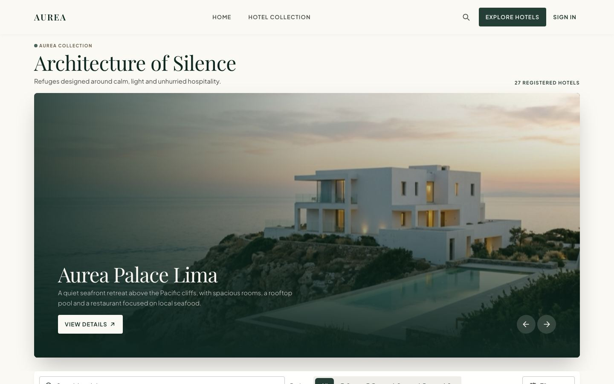
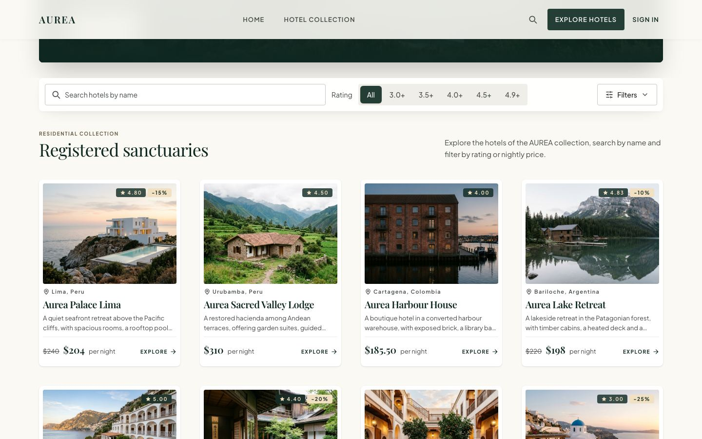
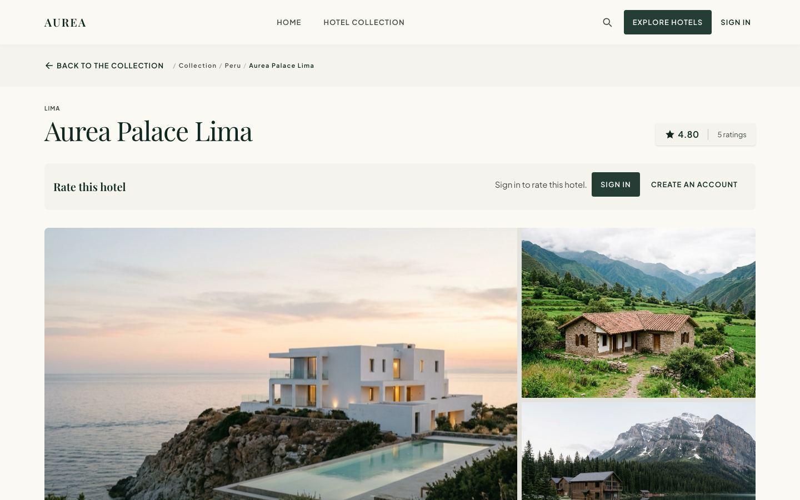
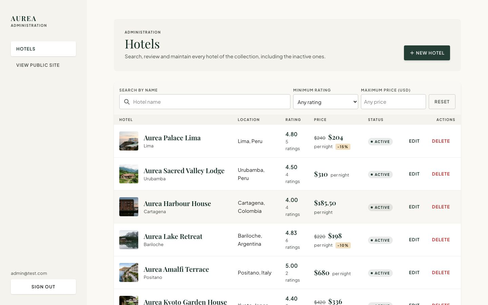
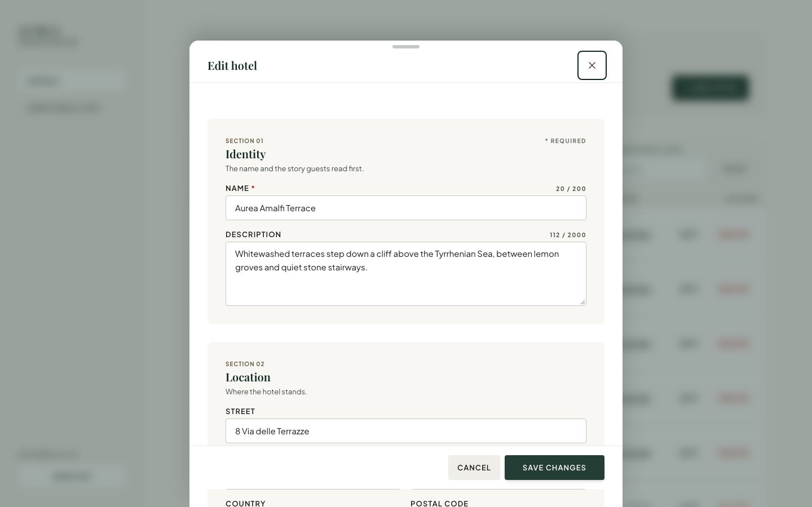
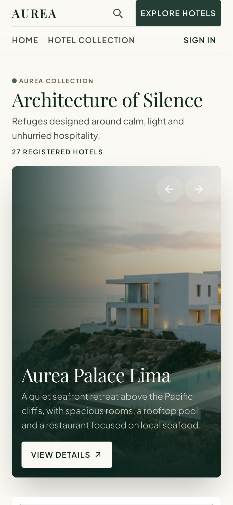
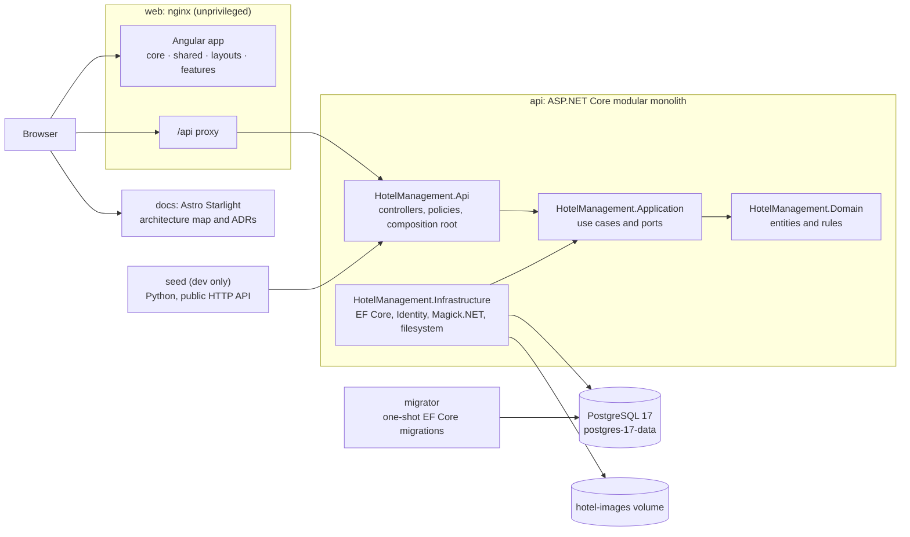

# Hotel Management System

<div align="center">

[](https://dotnet.microsoft.com/)
[](https://learn.microsoft.com/aspnet/core/)
[](https://angular.dev/)
[](https://www.typescriptlang.org/)
[](https://tailwindcss.com/)
[](https://www.postgresql.org/)
[](https://docs.docker.com/compose/)
[](https://github.com/kevnnard/hotels-cheil/actions/workflows/ci.yml)

<br/>

**Browse and administer the hotels of a fictitious chain: ASP.NET Core API, Angular web app and Astro Starlight docs, started with one command.**
Built as an interview validation exercise. Every application also runs on its own without Docker.

[⚡ Quickstart](#-60-second-quickstart) • [🎬 Tour](#-the-5-minute-tour) • [🧱 Architecture](#-system-architecture) • [✨ Features](#-features-matrix) • [🔌 API](#-api-reference) • [🧪 Testing](#-testing) • [🩺 Troubleshooting](#-troubleshooting)

</div>

---

## ⚡ 60-Second Quickstart

**Prerequisites:** Docker with the Compose plugin and Git. Nothing else is needed on the host.

```bash
git clone https://github.com/kevnnard/hotels-cheil.git
cd hotels-cheil
cp .env.dev.example .env.dev
```

Fill these variables in `.env.dev` (real env files are ignored by Git; never commit them):

| Variable | Value |
|:---|:---|
| `POSTGRES_PASSWORD` | Run `openssl rand -hex 24` and paste the output. Letters and digits only, because Compose treats `$` specially. |
| `ADMINISTRATOR_EMAIL` | The first administrator, for example an address on `example.test`. |
| `ADMINISTRATOR_PASSWORD` | 8 to 128 characters with at least one letter and one digit. |
| `SEED_GUEST_PASSWORD` | Optional, same rules. When set, the seed creates six guest accounts and their ratings; when empty, it skips them. |

The other variables already have working values. `JWT_SIGNING_KEY` is not needed in development: the API uses an ephemeral key.

```bash
docker compose --env-file .env.dev -f compose.dev.yaml up --build
```

> **What this does:**
> 1. Starts `db` (PostgreSQL 17) and `migrator`, which applies the EF Core migrations once and exits.
> 2. Starts `api` with `dotnet watch`, `web` (Angular build on nginx, proxying `/api`) and `docs`.
> 3. Runs `seed` once: 30 sample hotels (27 public, 3 inactive), 27 with photos, and, with `SEED_GUEST_PASSWORD`, 6 guest accounts rating 20 hotels.
> 4. Binds every port to `127.0.0.1` only.

| Service | URL | Port variable |
|:---|:---|:---|
| Web app | <http://localhost:4200> | `WEB_HTTP_PORT` (default 4200) |
| Admin panel | <http://localhost:4200/admin/login> | Same as the web app |
| API health | <http://localhost:5080/health> | `API_HTTP_PORT` (default 5080) |
| Docs | <http://localhost:4321> | `DOCS_HTTP_PORT` (default 4321) |
| PostgreSQL | `localhost:5433` | `POSTGRES_HOST_PORT` (default 5433) |

**Sign in as administrator** at `/admin/login` with `ADMINISTRATOR_EMAIL` and `ADMINISTRATOR_PASSWORD`. The API creates that account with the `Administrator` role on every start if it does not exist. Visitors register at `/account/register`.

```bash
docker compose --env-file .env.dev -f compose.dev.yaml down      # stop
docker compose --env-file .env.dev -f compose.dev.yaml down -v   # stop and delete the database and image volumes
docker compose --env-file .env.dev -f compose.dev.yaml up -d seed  # run the idempotent seed again without rebuilding
```

> **Warning: quotes in env files.** Compose strips the quotes around a value, and sourcing the file with `.` does too, but a script that extracts a line with `cut` keeps them. Write values without quotes, or strip them in the reader.

---

## 📸 Screenshots

| | |
|:---:|:---:|
| <br/>Landing page | <br/>Public catalogue with search and filters |
| <br/>Hotel detail with gallery and pricing | <br/>Admin hotel directory |
| <br/>Edit sheet with image slots and visibility | <br/>Responsive catalogue on a phone |

---

## 🧭 How to Use This Repository

| Mode | Who it's for | Workflow |
|:---|:---|:---|
| **Reviewer** | You want to see the system working quickly. | Run the [Quickstart](#-60-second-quickstart), then follow [the 5-minute tour](#-the-5-minute-tour). |
| **Developer** | You want hot reload and to run each app by hand. | Follow the [manual quickstart](#-manual-quickstart-without-docker). |
| **Contributor** | You want to change code safely. | Run the [test suites](#-testing) and the static checks; CI repeats them on every push. |

---

## 🎬 The 5-Minute Tour

1. Open <http://localhost:4200>. The home page shows a featured hotel and the catalogue: search by a name and pick a minimum rating or a maximum nightly price.
2. Open a hotel. Browse its gallery of up to three photos, see the nightly price in USD with the discounted price when there is one, and try the reservation card: it computes an estimate and sends nothing.
3. Sign in as a visitor at `/account/sign-in` (a seed guest if you set `SEED_GUEST_PASSWORD`, or register at `/account/register`) and rate the hotel from 1 to 5 stars. Rate again to change it.
4. Sign in at <http://localhost:4200/admin/login> with the administrator from `.env.dev`.
5. Click **New hotel**, fill the bottom sheet and save. Field errors from the API appear in the form.
6. Open the hotel for editing: the form is prefilled. Upload photos into the three image slots.
7. Switch its visibility off, then reload the public catalogue: the hotel is gone from the public site and still listed in the admin directory.
8. Delete the hotel and confirm.

---

## 🔧 Manual Quickstart (Without Docker)

| Tool | Version | Source |
|:---|:---|:---|
| .NET SDK | 10.0.402, or a newer patch of the 10.0.4xx band | `apps/api/global.json` (`rollForward: latestPatch`) |
| Node | 26.12.1 | `apps/web/Dockerfile`, `apps/docs/Dockerfile`, `.github/workflows/ci.yml` |
| pnpm | 12.15.0 | `packageManager` in `apps/web/package.json` and the Dockerfiles |
| PostgreSQL | 17 | `postgres:17` in the Compose files |
| Python | 3, standard library only (the container uses 3.13.9) | Only for the seed |

Run every command from the repository root unless a `cd` is shown. Create `.env.dev` as in the Quickstart first.

```bash
# 1. Load the environment into the shell
set -a; . ./.env.dev; set +a
export ConnectionStrings__Hotels="Host=localhost;Port=${POSTGRES_HOST_PORT};Database=${POSTGRES_DB};Username=${POSTGRES_USER};Password=${POSTGRES_PASSWORD}"
export Authentication__Administrator__Email="$ADMINISTRATOR_EMAIL"
export Authentication__Administrator__Password="$ADMINISTRATOR_PASSWORD"

# 2. Start PostgreSQL 17 (any server works; this starts only the dev database on port 5433)
docker compose --env-file .env.dev -f compose.dev.yaml up -d db

# 3. Apply the migrations (the API never migrates at startup)
cd apps/api && dotnet tool restore && dotnet ef database update --project src/HotelManagement.Infrastructure && cd ../..

# 4. Run the API on http://localhost:5080
dotnet run --project apps/api/src/HotelManagement.Api --launch-profile http
```

```bash
# 5. Web app (new terminal): open http://localhost:4200
cd apps/web && pnpm install && pnpm start

# 6. Docs (new terminal): http://localhost:4321, needs neither the API nor the database
cd apps/docs && pnpm install && pnpm run dev

# 7. Seed the sample hotels against the running API (with the environment of step 1 loaded)
API_BASE_URL=http://localhost:5080 SEED_IMAGES_DIR=docker/seed/images python3 docker/seed/seed_hotels.py
```

> **Tip:** the Angular dev server proxies `/api` to `http://127.0.0.1:5080` and listens on `localhost` only. Open `http://localhost:4200`, not `http://127.0.0.1:4200`.

The `http` launch profile sets the JWT issuer and audience. In development the images go to a per-user directory unless `Storage__Images__RootPath` names another absolute directory. Use `dotnet watch --project apps/api/src/HotelManagement.Api --launch-profile http` to reload on changes.

---

## 🧱 System Architecture



- **Clean Architecture** ([ADR-001](apps/docs/src/content/docs/decisions/adr-001-clean-architecture.md)): Domain depends on nothing, Application holds the use cases and ports, Infrastructure implements them, and Api hosts the controllers, policies and composition root.
- **Modular monolith** with application services, not CQRS or microservices.
- **Angular** is organized in `core`, `shared`, `layouts` and `features`, uses Signals and HttpClient, and never calls HTTP from presentation components. Guards only steer navigation; the API policies are the security boundary.
- **One origin:** the nginx container, or the Angular dev server, proxies `/api` to the API, so no CORS policy is needed.
- **Architecture map:** the home page of the docs is a hand-maintained model of the layers, components and endpoints. See [Architecture](apps/docs/src/content/docs/architecture.md).

```text
Public catalogue request
Browser ─GET /api/public/hotels?name=…&minRating=4─► nginx /api proxy ─► PublicHotelsController (anonymous)
        ─► application service ─► EF Core ─► PostgreSQL (active hotels only) ─► 200 page { items, page, totalItems, … }

Admin save
Bottom sheet ─PUT /api/hotels/{id} + Bearer token─► nginx /api proxy ─► JWT + persisted session check
        ─► policy hotels.update ─► HotelsController ─► application service ─► Domain rules
        ─► EF Core ─► PostgreSQL ─► 200 hotel   (or 400 with the failing field, shown in the form)
```

---

## 📦 Stack and Versions

| Application | Path | Stack |
|:---|:---|:---|
| API | `apps/api` | .NET SDK 10.0.402 (`net10.0`), ASP.NET Core, EF Core 10.0.13 with Npgsql 10.0.3, ASP.NET Core Identity with JWT bearer tokens, Magick.NET-Q16-AnyCPU 15.0.0, xUnit 2.9.3 |
| Web | `apps/web` | Angular 22.2.3 (CLI 22.2.4), TypeScript 6.0.3, Tailwind CSS 4.3.3, Vitest 5.0.5 with `@vitest/coverage-v8` 5.0.5, Playwright 1.64.1, pnpm 12.15.0 |
| Docs | `apps/docs` | Astro 7.4.2, Starlight 0.42.7 |
| Shared | | PostgreSQL 17, Node 26.12.1 in container builds and CI, `nginxinc/nginx-unprivileged:1.30.6-alpine3.24` for web and docs, `python:3.13.9-alpine3.22` for the seed |

## ✨ Features Matrix

| Area | Capability | Status |
|:---|:---|:---:|
| **Public site** | Landing page and catalogue of active hotels: search by name, minimum rating, maximum nightly price, paging | Implemented |
| | Hotel detail with a gallery of up to three photos, nightly price in USD and discounted price | Implemented |
| | Reservation estimate card (demo: computes a total, sends nothing) | Implemented |
| | Responsive layout, checked by Playwright at 360, 390, 768 and 1280 px | Implemented |
| **Visitors** | Registration and sign in; rate a hotel from 1 to 5 stars and change it later | Implemented |
| **Administration** | Separate sign in at `/admin/login`, open only to the `Administrator` role | Implemented |
| | Hotel directory with filters and paging | Implemented |
| | Create and edit in a bottom sheet, prefilled edit form, API field errors in the form | Implemented |
| | Three image slots, visibility switch, rating control, delete with confirmation | Implemented |
| **API** | Hotel CRUD with filters by name, minimum rating and maximum price, and pagination | Implemented |
| | Ratings 1 to 5, one per account and hotel, replaceable, `GET …/ratings/me` for the caller's score | Implemented |
| | Optional nightly price and discount percentage in USD | Implemented |
| | Up to three images per hotel, each kept within 400,000 bytes without quality loss, stored on a volume | Implemented |
| | Active or inactive state; inactive hotels hidden from the public routes | Implemented |
| | Identity with signed access tokens, revocable sessions, roles `Administrator` and `User`, policy-based authorization | Implemented |
| | Anonymous read-only public catalogue under `/api/public/hotels` | Implemented |
| | EF Core migrations applied by a one-shot migrator, never by the API at startup | Implemented |
| **Quality** | Backend suites for domain, application, infrastructure, HTTP and end-to-end, on a real PostgreSQL | Implemented |
| | Web unit and component tests with coverage thresholds that fail the run | Implemented |
| | Playwright tests for the catalogue, the responsive layout and the admin journey | Implemented, run locally |
| | Seed tests; GitHub Actions workflow that runs on every push | Implemented |
| **Production** | Rate limiting, security headers, HTTPS, secrets store, backups, monitoring | Planned |
| | Token refresh and cookie sessions, explicit CORS, image CDN | Considered |

---

## 🔌 API Reference

Interactive clients use `/api/hotels` with a bearer token. Policies: `hotels.read` and `hotels.rate` allow `Administrator` and `User`; `hotels.create`, `hotels.update` and `hotels.delete` allow `Administrator` only.

| Method | Path | Role | Purpose |
|:---|:---|:---|:---|
| `GET` | `/health` | Anonymous | Health check |
| `POST` | `/api/auth/register` | Anonymous | Create a `User` account (`email`, `password`) |
| `POST` | `/api/auth/login` | Anonymous | Get an access token (`email`, `password`) |
| `GET` | `/api/auth/me` | Any signed-in account | Current account, roles and session |
| `POST` | `/api/auth/logout` | Any signed-in account | Revoke the session |
| `GET` | `/api/public/hotels`, `/api/public/hotels/{id}` | Anonymous | Active hotels only |
| `GET` | `/api/public/hotels/{id}/image`, `/api/public/hotels/{id}/images/{position}` | Anonymous | Image bytes of active hotels |
| `GET` | `/api/hotels`, `/api/hotels/{id}` | `Administrator`, `User` | List and read, including inactive hotels |
| `POST` | `/api/hotels` | `Administrator` | Create a hotel |
| `PUT` | `/api/hotels/{id}` | `Administrator` | Replace the hotel details |
| `PUT` | `/api/hotels/{id}/status` | `Administrator` | Show or hide (`isActive`) |
| `DELETE` | `/api/hotels/{id}` | `Administrator` | Delete a hotel |
| `POST` | `/api/hotels/{id}/ratings` | `Administrator`, `User` | Rate or re-rate (`score` 1 to 5) |
| `GET` | `/api/hotels/{id}/ratings/me` | `Administrator`, `User` | Caller's own score |
| `PUT`, `DELETE` | `/api/hotels/{id}/images/{position}`, `/api/hotels/{id}/image` | `Administrator` | Upload (multipart field `image`) or remove |
| `GET` | `/api/hotels/{id}/images/{position}`, `/api/hotels/{id}/image` | `Administrator`, `User` | Image bytes |

List filters: `name`, `minRating`, `maxPrice`, `page` and `pageSize` (1 to 100, default 20). Positions are 0, 1 and 2, and `/image` is position 0. Full contract: [Hotel API](apps/docs/src/content/docs/hotel-api.md), [Hotel images](apps/docs/src/content/docs/hotel-images.md) and [Authentication](apps/docs/src/content/docs/authentication.md).

<details>
<summary><strong>Ready-to-run curl examples</strong></summary>

```bash
export API=http://localhost:5080

# 1. Public list with filters (no token)
curl "$API/api/public/hotels?name=aurea&minRating=4&maxPrice=400&page=1&pageSize=10"

# 2. Sign in, then copy accessToken from the response into TOKEN
curl -X POST "$API/api/auth/login" -H "Content-Type: application/json" \
  -d "{\"email\":\"$ADMINISTRATOR_EMAIL\",\"password\":\"$ADMINISTRATOR_PASSWORD\"}"
export TOKEN=<accessToken>

# 3. Create a hotel (Administrator); copy its id into HOTEL_ID
curl -X POST "$API/api/hotels" -H "Authorization: Bearer $TOKEN" -H "Content-Type: application/json" \
  -d '{"name":"Grand Plaza","city":"Lisbon","country":"Portugal","pricePerNight":199.99,"discountPercent":15}'
export HOTEL_ID=<id>

# 4. Rate the hotel (Administrator or User)
curl -X POST "$API/api/hotels/$HOTEL_ID/ratings" -H "Authorization: Bearer $TOKEN" \
  -H "Content-Type: application/json" -d '{"score":4}'

# 5. Hide it from the public catalogue (Administrator)
curl -X PUT "$API/api/hotels/$HOTEL_ID/status" -H "Authorization: Bearer $TOKEN" \
  -H "Content-Type: application/json" -d '{"isActive":false}'
```

</details>

---

## 🧪 Testing

| Suite | What it covers | Command | Tests | Needs |
|:---|:---|:---|:---:|:---|
| API domain | Entities and rules | `dotnet test apps/api/tests/HotelManagement.Domain.Tests` | 163 | Nothing |
| API application | Use cases with in-memory doubles | `dotnet test apps/api/tests/HotelManagement.Application.Tests` | 117 | Nothing |
| API infrastructure | Persistence, image processing, storage | `dotnet test apps/api/tests/HotelManagement.Infrastructure.Tests` | 197 | `HOTEL_TEST_CONNECTION` |
| API HTTP | Endpoints, tokens, revocation, policies | `dotnet test apps/api/tests/HotelManagement.Api.Tests` | 177 | `HOTEL_TEST_CONNECTION` |
| API end-to-end | API as a separate process over a real socket | `dotnet test apps/api/tests/HotelManagement.E2E.Tests` | 46 | `HOTEL_TEST_CONNECTION` |
| Web unit and component | Components, forms, services, interceptor, guards | `pnpm test` in `apps/web` | 704 | Nothing |
| Web Playwright | Catalogue, responsive layout, admin journey | `pnpm e2e` in `apps/web` | 57 | The running seeded stack and three variables |
| Seed | The seed script | `python3 -I -m unittest discover -s docker/seed/tests -t docker/seed` | 55 | Nothing |

> **Tip:** `HOTEL_TEST_CONNECTION` must point to a database named `hotels_test` on a disposable PostgreSQL 17 server. The suites create and drop their own uniquely named database, and fail rather than skip when the variable or the server is missing.

**Playwright** runs against the seeded development stack, because the public tests expect the 30 seed hotels. Start the stack, then from `apps/web`:

```bash
pnpm exec playwright install chromium
BASE_URL=http://localhost:4200 E2E_ADMIN_EMAIL="$ADMINISTRATOR_EMAIL" E2E_ADMIN_PASSWORD="$ADMINISTRATOR_PASSWORD" pnpm e2e
```

The 57 tests run over four projects: `desktop` (1280 px), `tablet` (768 px), `mobile-360` and `mobile-390`; the admin tests run on desktop and at 390 px. Without `BASE_URL`, Playwright starts its own dev server on `127.0.0.1:4200`.

**Coverage** ([ADR-020](apps/docs/src/content/docs/decisions/adr-020-test-coverage.md)):

| Side | Command | Result |
|:---|:---|:---|
| Web | `pnpm test:coverage` in `apps/web` | 98.31% of lines; fails below 95 lines, 90 branches, 94 functions, 95 statements. Open `apps/web/coverage/web/index.html`. |
| API domain | `dotnet test apps/api/tests/HotelManagement.Domain.Tests --collect:"XPlat Code Coverage"` | 99.08% of lines, measured only |
| API application | `dotnet test apps/api/tests/HotelManagement.Application.Tests --collect:"XPlat Code Coverage"` | 98.42% of lines, measured only |

**Static checks:** `pnpm lint` and `pnpm typecheck` in `apps/web`, `pnpm run check` in `apps/docs`, and `dotnet format apps/api/HotelManagement.slnx --verify-no-changes` for the API.

**CI** (`.github/workflows/ci.yml`) runs on every push and pull request with four jobs: `web` (install, lint, typecheck, coverage run, build), `docs` (check, build), `api` (Release build, `dotnet format --verify-no-changes`, every backend suite against a PostgreSQL 17 service) and `images` (builds the web, docs and API Dockerfiles). It does not deploy and does not run Playwright, which needs the full stack and the administrator credentials. See [ADR-021](apps/docs/src/content/docs/decisions/adr-021-delivery-compose-and-ci.md).

---

## 🔐 Environment Variables

Three samples are versioned: `.env.dev.example` (development stack), `.env.prod.example` (production configuration, adds `JWT_SIGNING_KEY`) and `.env.example` (every variable the Compose files read). Copy one, fill it locally and never commit the copy.

<details>
<summary><strong>Full variable reference</strong></summary>

| Name | Used by | Required | Placeholder meaning |
|:---|:---|:---|:---|
| `ASPNETCORE_ENVIRONMENT` | migrator, api | Yes | `Development` or `Production` |
| `POSTGRES_DB` | db, migrator, api | Yes | `hotels_dev` |
| `POSTGRES_USER` | db, migrator, api | Yes | `hotels_dev` |
| `POSTGRES_PASSWORD` | db, migrator, api | Yes | `<output of openssl rand -hex 24>` |
| `POSTGRES_HOST_PORT` | db (dev) | No | `5433` |
| `API_HTTP_PORT` | api | No | `5080` (dev), `8080` (prod) |
| `WEB_HTTP_PORT` | web | No | `4200` |
| `DOCS_HTTP_PORT` | docs | No | `4321` |
| `ADMINISTRATOR_EMAIL` | api, seed | Yes in dev and prod | `admin@example.test` |
| `ADMINISTRATOR_PASSWORD` | api, seed | Yes in dev and prod | `<8 to 128 characters with a letter and a digit>` |
| `SEED_GUEST_PASSWORD` | seed (dev) | No | `<8 to 128 characters with a letter and a digit>` |
| `JWT_SIGNING_KEY` | api | Yes in prod; ephemeral key in dev | `<output of openssl rand -base64 48>` |
| `JWT_ISSUER` | api | No | `hotels-api` |
| `JWT_AUDIENCE` | api | No | `hotels-api-clients` |
| `JWT_ACCESS_TOKEN_LIFETIME_MINUTES` | api | No | `15` |
| `ConnectionStrings__Hotels` | API and migrations, manual run | Yes | `Host=localhost;Port=5433;Database=hotels_dev;Username=hotels_dev;Password=<password>` |
| `Storage__Images__RootPath` | API, manual run | Outside development | `<absolute directory outside the repository>` |
| `HOTEL_TEST_CONNECTION` | backend Infrastructure, Api and E2E tests | Yes for those suites | `Host=localhost;Port=5433;Database=hotels_test;Username=<user>;Password=<password>` |
| `BASE_URL` | Playwright | No | `http://localhost:4200` |
| `E2E_ADMIN_EMAIL`, `E2E_ADMIN_PASSWORD` | Playwright admin tests | Yes for those tests | The administrator of your `.env.dev` |
| `API_BASE_URL`, `SEED_IMAGES_DIR` | seed, manual run | No | `http://localhost:5080`, `docker/seed/images` |

The API reads its settings with `__` for nesting, so the Compose files map these variables to names such as `Authentication__Jwt__SigningKey`. The full list is in [Authentication](apps/docs/src/content/docs/authentication.md) and [Development](apps/docs/src/content/docs/development.md).

</details>

---

## 📂 Repository Layout

```text
hotels-cheil/
├── apps/
│   ├── api/                       # ASP.NET Core modular monolith
│   │   ├── src/
│   │   │   ├── HotelManagement.Domain/          # Entities and rules, no dependencies
│   │   │   ├── HotelManagement.Application/     # Use cases and ports
│   │   │   ├── HotelManagement.Infrastructure/  # EF Core, Identity, Magick.NET, filesystem, migrations
│   │   │   └── HotelManagement.Api/             # Controllers, policies, composition root
│   │   ├── tests/                 # Domain, Application, Infrastructure, Api, E2E and TestSupport
│   │   ├── global.json            # Pinned .NET SDK
│   │   └── Dockerfile             # dev, migrator and non-root runtime stages
│   ├── web/                       # Angular app
│   │   ├── src/app/               # core, shared, layouts, features
│   │   ├── e2e/                   # Playwright tests
│   │   ├── proxy.conf.json        # Dev server /api proxy
│   │   └── Dockerfile             # Node build, unprivileged nginx runtime
│   └── docs/                      # Astro Starlight site
│       ├── src/content/docs/      # Pages and ADRs
│       ├── src/data/architecture.ts  # Model of the architecture map
│       └── Dockerfile
├── docker/
│   ├── nginx/                     # web.conf (with the /api proxy) and docs.conf
│   └── seed/                      # hotels.json, images/, seed_hotels.py and tests/
├── .github/workflows/ci.yml       # CI workflow
├── compose.yaml                   # Common services
├── compose.dev.yaml               # Self-contained development stack with the seed
├── compose.prod.yaml              # Production overlay
└── .env.example, .env.dev.example, .env.prod.example
```

---

## 🩺 Troubleshooting

| Symptom | Cause | Fix |
|:---|:---|:---|
| `127.0.0.1:4200` refuses connections with `pnpm start` | The dev server listens on `localhost`, which resolves to `[::1]` | Open `http://localhost:4200` |
| Playwright starts a second dev server | `BASE_URL` is not set, so it starts `pnpm start --host 127.0.0.1` | Set `BASE_URL=http://localhost:4200` |
| Port 4200 already in use | The Compose `web` container and `pnpm start` run together | Stop one, or set `WEB_HTTP_PORT` to another port in `.env.dev` |
| A script reads a value with quotes | `cut` keeps the quotes that Compose and `.` strip | Write values without quotes, or strip them in the script |
| `NETSDK1064` on a host build | The dev API container rewrites `obj` through its source mount | Stop the container, then run `dotnet restore --force` |
| Playwright asks for a newer Chromium | The browser build does not match Playwright 1.64.1 | `pnpm exec playwright install chromium` |
| `docker compose` says a variable is not set | `SEED_GUEST_PASSWORD` is missing from the env file, or `ADMINISTRATOR_*` is empty | Keep `SEED_GUEST_PASSWORD=` in the file (empty is fine) and fill `ADMINISTRATOR_EMAIL` and `ADMINISTRATOR_PASSWORD` |
| Seed fails on a photo upload | The API answers `422` for an image it cannot fit into 400,000 bytes without quality loss | Use a smaller JPEG; the seed photos are about 900 px wide and 150 to 260 KB |

---

## 🚀 Production Considerations

The production configuration is `compose.yaml` with `compose.prod.yaml` and `.env.prod` (from `.env.prod.example`). It uses the non-root runtime image of the API and publishes no PostgreSQL port. Check it with `docker compose --env-file .env.prod -f compose.yaml -f compose.prod.yaml config`. Nothing is deployed.

None of these is implemented; reasons and scope are in [Production considerations](apps/docs/src/content/docs/production-considerations.md):

- Rate limiting and lockout on login.
- Security headers, HSTS and HTTPS termination.
- An explicit CORS policy (none is needed today because the web and the API share an origin).
- Token refresh and httpOnly cookie sessions (the token lives in `sessionStorage`, see [ADR-019](apps/docs/src/content/docs/decisions/adr-019-admin-session-storage.md)).
- Secrets management beyond environment variables, backups of the database and the image volume, monitoring, logs and an image CDN.

## 🚧 Known Limitations

- The admin directory has no filter by active state.
- Three seed hotels have no photo: the three inactive ones. Three visible hotels reuse the photo of a similar hotel (Banff, Chiang Mai and Edinburgh) because image generation ran out of quota.
- No email verification or password reset.
- No real booking: the reservation card is a demo and sends nothing.
- The quote, suites, amenities and manager sections of the detail page are static sample content.
- The architecture map is maintained by hand, not generated from the code.

## 📚 Documentation

| Page | Contents |
|:---|:---|
| [Overview](apps/docs/src/content/docs/index.md) | Introduction and status of each capability |
| [Architecture](apps/docs/src/content/docs/architecture.md) | Layers, components and the architecture map |
| [Development](apps/docs/src/content/docs/development.md) | Setup, Compose, seed, migrations, testing, CI |
| [Hotel domain rules](apps/docs/src/content/docs/hotel-domain.md) | Fields, limits and validation of the hotel model |
| [Hotel API](apps/docs/src/content/docs/hotel-api.md) · [Hotel images](apps/docs/src/content/docs/hotel-images.md) · [Authentication](apps/docs/src/content/docs/authentication.md) | HTTP contract |
| [Decision records](apps/docs/src/content/docs/decisions/index.md) | ADR-001 to ADR-021 |

Conventions: no comments in code or configuration files, exact dependency versions without ranges, every relevant decision recorded as an ADR with capabilities labelled Implemented, Planned, Considered or Discarded, and secrets never in Git (only the `.env*.example` samples are versioned).

---

Built by Kevin Londoño ([@kevnnard](https://github.com/kevnnard)) as an interview validation exercise.
